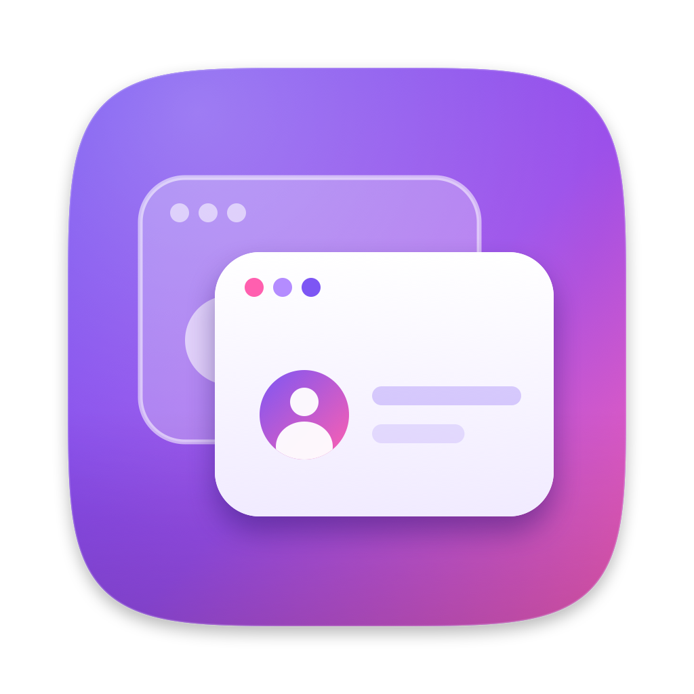
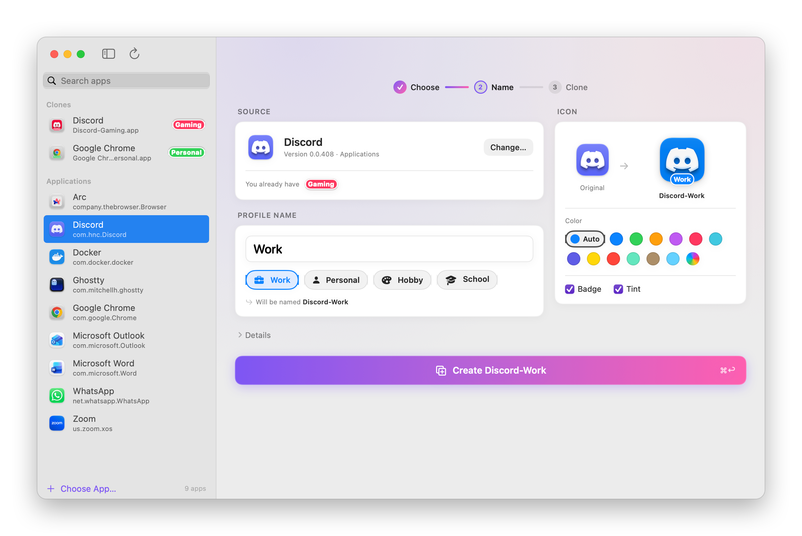
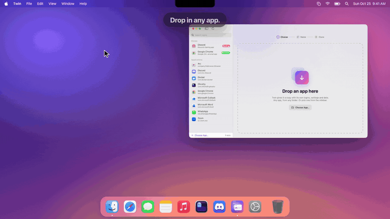
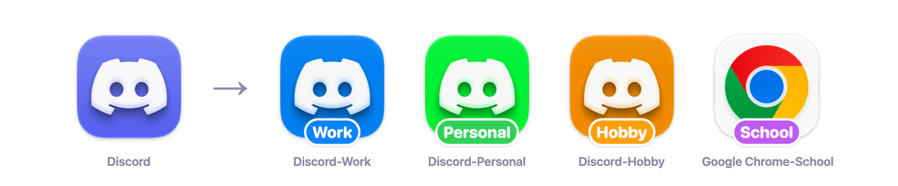
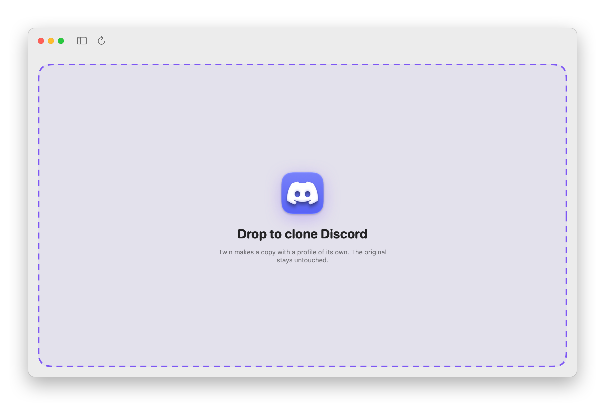
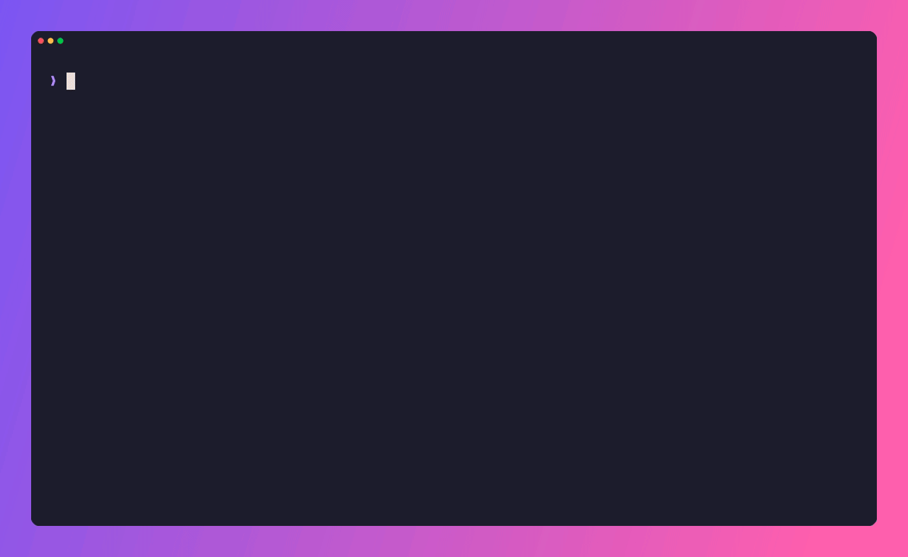
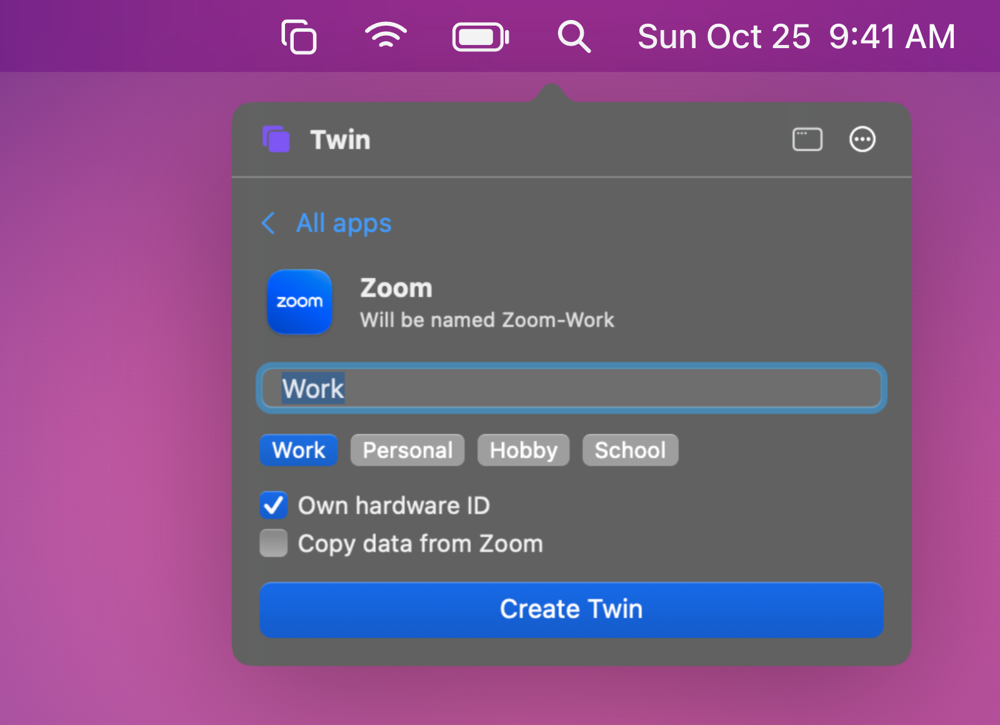
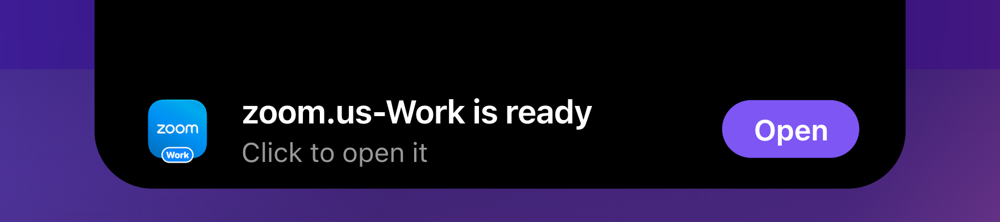
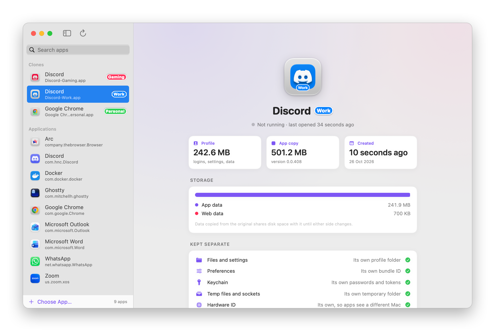

<div align="center">



# Twin

### One app. Many lives.

Clone any Mac app into a **twin** with its own isolated profile, a recolored icon and a label badge.<br>
Slack for work, Slack for you, side by side, never sharing a login.

[](https://github.com/mukhayyar/twin/releases/latest)
[](https://github.com/mukhayyar/twin/releases)
[](#install)
[](https://github.com/mukhayyar/twin/actions/workflows/ci.yml)
[](LICENSE)

**[Download Twin.app](https://github.com/mukhayyar/twin/releases/latest)** &nbsp;·&nbsp; **[Install the CLI](#install)** &nbsp;·&nbsp; **[▶ Watch the film](assets/twin-promo.mp4)**

<br>

<picture>
  <source media="(prefers-color-scheme: dark)" srcset="assets/app-dark.png">
  
</picture>

</div>

<br>

## ✦ Why Twin

Most Mac apps only let you be one person at a time. Signing in to a second Slack workspace, a second Discord account or a separate browser profile means logging out, juggling windows or giving up.

Twin makes a full copy of the app that **believes it's on its own machine**. Each twin keeps its own logins, settings, caches and window state, gets its own Dock icon, and runs alongside the original, sharing nothing with it:

| Kept separate per twin | |
|---|---|
| 📁 **Files & settings** | Home folder, `~/Library`, preferences |
| 🔐 **Secrets** | Keychain items (tokens, passwords, encryption keys) |
| 🔌 **Running state** | `/tmp` sockets and lock files, temp and cache folders |
| 🖥️ **Hardware fingerprint** | MAC addresses, hardware UUID and serial number |

> [!IMPORTANT]
> **Twins also change the hardware fingerprint, unless you turn it off.** By default each twin sees its own stable MAC addresses, hardware UUID and serial number, so apps that identify a machine by its hardware treat it as a separate device. That's what gives a RustDesk twin its own ID. For apps licensed per device, untick **Own hardware ID** in the app (or pass `--share-hardware` to the CLI, on macOS or Linux) and the twin sees the computer's real hardware instead. Everything else stays separate either way.

<div align="center">
<a href="assets/twin-promo.mp4"></a>
<br><sub>▶ Click for the full film</sub>
<br><br>

</div>

<br>

## Two ways to use it

<table>
<tr>
<th width="50%">🖥️ &nbsp;The app</th>
<th width="50%">⌨️ &nbsp;The CLI</th>
</tr>
<tr>
<td></td>
<td></td>
</tr>
<tr>
<td>A native SwiftUI app. Drop an app on the window, the Dock icon, the menu bar icon or the notch, pick a label, press <kbd>⌘</kbd> <kbd>↩</kbd>. Manage, inspect and update your twins from the sidebar.</td>
<td>A <a href="https://github.com/charmbracelet/bubbletea">Bubble Tea</a> TUI. Filter, <kbd>tab</kbd> through quick picks, <kbd>enter</kbd>. Or skip the UI entirely: <code>twin Slack Work</code>.</td>
</tr>
</table>

### Clone without opening the window

<table>
<tr>
<th width="50%">From the menu bar</th>
<th width="50%">From the notch</th>
</tr>
<tr>
<td></td>
<td></td>
</tr>
<tr>
<td>Click Twin's menu bar icon, pick an app, name it, create. Or drop an app on the icon.</td>
<td>Start dragging any app and a pill drops down from the notch: drop the app there. It shows the clone's progress too, then opens the new twin.</td>
</tr>
</table>

### Inside every twin

<div align="center">
<picture>
  <source media="(prefers-color-scheme: dark)" srcset="assets/details-dark.png">
  
</picture>
</div>

Select a twin to see whether it's running and how much memory it uses, how much space its profile takes and where it goes, what's kept separate, and an **Update Twin** button when the original app has a newer version.

## Install

### The app

1. Download **`Twin-x.y.z.dmg`** from the [latest release](https://github.com/mukhayyar/twin/releases/latest), open it and drag **Twin** to **Applications**.
2. Twin is open source and ad-hoc signed rather than notarized, so the first launch needs a right-click → **Open**, or:

   ```bash
   xattr -dr com.apple.quarantine /Applications/Twin.app
   ```

   Or with Homebrew: `brew install --cask mukhayyar/tap/twin`

Twin keeps itself up to date: it checks for new versions once a day (or **Twin → Check for Updates…**), and installs them in one click.

### The CLI

```bash
brew install mukhayyar/tap/twin
```

or

```bash
curl -fsSL https://raw.githubusercontent.com/mukhayyar/twin/main/install.sh | bash
```

<details>
<summary>Other ways</summary>

<br>

**With Go**

```bash
go install github.com/mukhayyar/twin/cmd/twin@latest
```

**By hand.** Download the archive for your system from the [releases](https://github.com/mukhayyar/twin/releases/latest), extract it and put `twin` on your `PATH`. Verify it with `checksums.txt`.

</details>

Update the CLI any time with `twin --update` (or `brew upgrade twin`).

### Linux and Windows

The CLI runs there too. On Linux, download **`twin-x.y.z-x86_64.AppImage`** (or `-aarch64`), `chmod +x` it and run it; Homebrew and the installer above work as well. On Windows, download **`twin-x.y.z-windows-amd64.exe`** and run it in a terminal.

- **Linux:** a twin is a new app-menu entry with its own profile: files and settings (HOME and XDG folders), `/tmp`, app sockets and hardware fingerprint are all kept apart. Chromium and Electron apps keep their saved passwords inside the twin's profile instead of the shared desktop keyring; other apps' keyring entries stay shared. Flatpak apps work; Snap apps can't be twinned. RustDesk gets extra care: see [the FAQ](#faq).
- **Windows (experimental):** a twin is a Start Menu shortcut that runs the app with its own user folders. Apps that only allow one running copy won't open twice.

## Usage

### In the app

| | |
|---|---|
| **Choose an app** | Drop it on the window or the Dock icon, pick it from the sidebar, or press <kbd>⌘</kbd> <kbd>O</kbd> |
| **Name the twin** | Type a label or click a quick pick: Work, Personal, Hobby, School |
| **Style the icon** | Auto color (or pick your own), badge on/off, tint on/off, previewed live |
| **Hardware ID** | **Own hardware ID** is on by default; untick it for apps licensed per device |
| **Copy data** | Off by default: a twin starts fresh. Tick **Copy data from …** to start it with a copy of the original's settings and data |
| **Create** | <kbd>⌘</kbd> <kbd>↩</kbd>. Twin shows each step, then offers to open it |
| **Manage** | Right-click a twin in the sidebar to Open, Show in Finder, Copy Path or Move to Trash (<kbd>⌘</kbd> <kbd>Z</kbd> undoes it) |
| **Inspect a twin** | Select it in the sidebar: whether it's running and how much memory it uses, its disk use and where it goes, what's kept separate, and an **Update Twin** button when the original app has a newer version |
| **From the menu bar** | Click Twin's menu bar icon to clone without opening the window, or drop an app on it |
| **From the notch** | Start dragging any app and a Dynamic Island-style pill drops down from the top of the screen: drop the app there to clone it. The pill also shows each clone's progress; click it to open the new twin |

| Shortcut | |
|---|---|
| <kbd>⌘</kbd> <kbd>O</kbd> | Choose App… |
| <kbd>⌘</kbd> <kbd>↩</kbd> | Create the twin |
| <kbd>⌘</kbd> <kbd>L</kbd> | Open the selected twin |
| <kbd>⌘</kbd> <kbd>R</kbd> | Reveal in Finder |
| <kbd>⌘</kbd> <kbd>⌫</kbd> | Move twin to Trash (<kbd>⌘</kbd> <kbd>Z</kbd> to undo) |
| <kbd>⌘</kbd> <kbd>F</kbd> | Search apps |
| <kbd>⇧</kbd> <kbd>⌘</kbd> <kbd>R</kbd> | Rescan Applications |

### In the terminal

```text
twin                        pick an app interactively
twin Slack Work             clone Slack as Slack-Work
twin ~/Downloads/Foo.app    clone an app from anywhere
twin Slack Hobby -c pink    clone with a pink icon and badge
twin -n                     try the whole flow without touching the disk
```

> [!TIP]
> Drag an app from Finder into the terminal while `twin` is open, and it's selected.

| Flag | |
|---|---|
| `-n`, `--dry-run` | Walk through everything without changing the disk |
| `-c`, `--color` | `auto` (default), `none`, a name (`blue` `green` `orange` `purple` `pink` `teal` `indigo` `yellow` `red` `mint` `brown` `cyan`) or `#RRGGBB` |
| `--no-badge` | Keep the label off the icon |
| `--share-hardware` | Let the twin see the computer's real hardware IDs instead of its own (macOS, Linux) |
| `--copy-data` | Start the twin with a copy of the original's settings and data instead of a fresh profile |
| `--display :N` | Run the twin on X display `:N`, such as an Xvnc desktop, with that desktop's session, checking first that it opens (Linux) |
| `--env KEY=VALUE` | Set a variable in the twin's launcher; repeatable (Linux) |
| `--service` | Keep the twin's background server running with a systemd user service, for apps Twin knows, like RustDesk (Linux) |
| `-u`, `--update` | Update twin to the latest release |
| `-v`, `--version` | Print the version |

| Command | |
|---|---|
| `twin remove TWIN` | Stop a twin and delete its service, launcher, menu entry and profile. Asks first; `-y` doesn't (Linux) |
| `twin rustdesk-password TWIN` | Set a RustDesk twin's permanent password, no root needed. It's read from a prompt or stdin, never the command line (Linux) |

| Key | |
|---|---|
| <kbd>↑</kbd> <kbd>↓</kbd> / <kbd>j</kbd> <kbd>k</kbd> | Move |
| <kbd>/</kbd> | Filter apps |
| <kbd>enter</kbd> | Choose / create |
| <kbd>tab</kbd> | Cycle quick-pick labels |
| <kbd>ctrl</kbd> <kbd>o</kbd> | Toggle own hardware ID |
| <kbd>ctrl</kbd> <kbd>d</kbd> | Toggle copying the original's data |
| <kbd>esc</kbd> | Back |
| <kbd>o</kbd> | Open the new twin |
| <kbd>q</kbd> | Quit |

## Icons & badges

Every twin is repainted so you can tell them apart at a glance in the Dock, Finder and ⌘-Tab:

- **Recolor:** the icon's dominant hue is rotated to the label's color, keeping its shading. Near-monochrome icons keep their colors.
- **Badge:** the label is stamped on a pill at the bottom of the icon.

| Label | Color |
|---|---|
| Work |  |
| Personal |  |
| Hobby |  |
| School |  |
| Anything else | Picked from         by the label's hash, so it's always the same |

## FAQ

<details>
<summary><b>Which apps work?</b></summary>

<br>

Most apps that keep their data under `~/Library`: Electron apps (Slack, Discord, VS Code, Notion…), Chromium browsers, and most native apps. Known exceptions:

- **Mac App Store apps** usually refuse to launch after re-signing (receipt checks).
- Apps that rely on **iCloud or Keychain sharing entitlements** lose them, because ad-hoc signing can't keep a developer's entitlements.
- Apps that enforce a **single instance** through a server-side session may still log one twin out.
- Apps that install **system-wide services** (privileged helpers, launch daemons) share those services between twins.

</details>

<details>
<summary><b>How do permissions work (Screen Recording, Accessibility…)?</b></summary>

<br>

Each twin is its own app to macOS, with its own entry in **System Settings → Privacy & Security**, so grant permissions to the twin itself (e.g. *RustDesk-Work*). macOS ties them to the exact build, so after you re-create a twin, switch its permissions off and on again. Twins made before Twin 0.3 can't receive permissions; re-create them.

</details>

<details>
<summary><b>What happens when the original app updates?</b></summary>

<br>

Twins are independent copies, so they keep their version. Re-create the twin with the same label to refresh it. The profile in `~/.app_profiles` is kept, so you stay signed in.

</details>

<details>
<summary><b>Can a twin start with my existing settings?</b></summary>

<br>

Yes: tick **Copy data from …** (or pass `--copy-data`). Twin copies the original's app data, preferences, cookies and sandbox container into the new twin's profile, skipping caches. On macOS the copies are APFS clones, so even gigabytes copy instantly and take no extra space until they change. It never overwrites data a twin already has.

Two things don't come along: sign-ins kept in the keychain (each twin has its own keychain items, so some apps ask you to sign in again), and anything the app keeps on a server. Copying also brings over any device identity the app stores in its settings, so on macOS leave it off for apps like RustDesk where each copy should be a different device. On Linux, Twin knows RustDesk and handles it (see below). Quit the original first for the cleanest copy.

</details>

<details>
<summary><b>Can I run a second RustDesk on the same Linux computer?</b></summary>

<br>

Yes, on its own ID, for example on a second desktop served by Xvnc on display `:3`:

```bash
twin -y --copy-data RustDesk Alice --display :3 --service
twin rustdesk-password RustDesk-Alice     # optional: give it a different permanent password
```

- **Its own ID.** The twin sees its own machine-id and MAC addresses, so RustDesk gives it a new ID and key pair. Twin asks the twin's RustDesk for its ID before finishing, and refuses to finish one that answers to the original's.
- **The same settings and password.** RustDesk encrypts its secrets with the machine-id, which the twin doesn't share. With `--copy-data`, Twin decrypts the permanent password, unlock PIN, proxy password and 2FA secret with this computer's key and encrypts them again for the twin. The original's ID, keys and trusted devices stay behind. Server settings and everything else come along.
- **It stays up.** RustDesk's system service kills every process called `rustdesk --server` when it restarts its own. The twin runs under its own name, so the service leaves it alone. `--service` adds a systemd user service (`systemctl --user status twin-rustdesk-alice`) that starts it again if anything else stops it. User services start when you log in; Twin tells you the `sudo loginctl enable-linger` command if you want it running from boot.
- **The right screen.** `--display :3` runs it on that X display and tells RustDesk to use X11 there, even when the main desktop runs Wayland. It uses that desktop's session: its D-Bus, and its X authority, or your `~/.Xauthority` when it has none. Before the app starts, Twin checks it can open the display. A wrong X authority stops it with the server's reason, which `journalctl --user -u twin-rustdesk-alice` shows, instead of leaving a server that can't see the screen. The twin's menu entry only shows on that desktop, since that's where it opens.

When the twin's server starts, RustDesk's tray icon on the main desktop disappears: every RustDesk server closes all RustDesk tray icons when it starts. The icon comes back the next time RustDesk restarts its own server. Twins of RustDesk's flatpak aren't possible, since the flatpak sees the real hardware; use the `.deb`, `.rpm` or AppImage.

</details>

<details>
<summary><b>How do I remove a twin?</b></summary>

<br>

In the app, right-click it in the sidebar → **Move to Trash**. From the terminal:

```bash
rm -rf "/Applications/Slack-Work.app" ~/.app_profiles/Slack-Work
```

On Linux, `twin remove Slack-Work` stops the twin and its service and deletes its launcher, menu entry and profile. It asks first; `-y` doesn't.

</details>

<details>
<summary><b>Is it safe?</b></summary>

<br>

Twin never touches the original app or its data. Everything it creates is a separate `.app` in `/Applications` and a folder in `~/.app_profiles`. Use `twin --dry-run` to see exactly what would happen first.

</details>

## Build from source

```bash
git clone https://github.com/mukhayyar/twin && cd twin

go run ./cmd/twin --dry-run           # the CLI (Go 1.26+)
scripts/build-app.sh && open dist/Twin.app   # the app (Xcode or Command Line Tools)
```


## Roadmap

- [x] macOS app and CLI
- [x] Auto icon recolor and label badges
- [x] Full isolation on macOS, including keychain and hardware fingerprint
- [x] Linux CLI: `.desktop` twins with XDG profiles
- [x] Windows CLI (experimental): shortcut twins with their own user folders and temp
- [x] Homebrew tap
- [x] Full isolation on Linux: `/tmp`, app sockets, hardware fingerprint, Chromium/Electron passwords
- [x] Optionally start a twin with a copy of the original's data
- [x] One-file downloads (`.dmg`, AppImage, `.exe`) and built-in updates
- [x] Menu bar quick clone and the notch island
- [x] RustDesk twins on Linux: their own ID with the same settings and password, on any display, kept running
- [ ] Twin.app icon in the new macOS 26 format

## Credits

Built with [Bubble Tea](https://github.com/charmbracelet/bubbletea), [Bubbles](https://github.com/charmbracelet/bubbles), [Lip Gloss](https://github.com/charmbracelet/lipgloss) and [VHS](https://github.com/charmbracelet/vhs) by Charm, plus SwiftUI. Started life as a 100-line shell script.

<div align="center">
<br>
<sub>MIT © Tsaqif Mukhayyar</sub>
</div>
